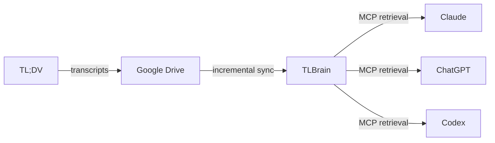

# 🧠 TLBrain `v2.0.1`

Personal semantic memory for Claude and ChatGPT — built on top of your client calls.
 
TLBrain indexes meeting transcripts from TL;DV, stores everything in Google Drive, and lets Claude and ChatGPT search through your conversations by meaning — without you having to paste anything manually. Connect your preferred assistant through MCP; Codex is supported too.
 

 
Works with **Claude** · **ChatGPT** · **Codex** via remote MCP
Google Drive + Qdrant + Gemini · Shared corpus for configured accounts · Near-zero infrastructure cost · Deploy with one command
 
---
 
## Contents
 
- [Who it's for](#-who-its-for)
- [Example queries](#-example-queries)
- [How it works in practice](#-how-it-works-in-practice)
- [Quick Start](#-quick-start)
- [Compatibility with existing data](#-compatibility-with-existing-data)
- [Why TLBrain](#-why-tlbrain)
- [Why not just use Claude Projects?](#-why-not-just-use-claude-projects)
- [Why MCP?](#-why-mcp)
- [Cost Breakdown](#-cost-breakdown)
- [Limitations](#%EF%B8%8F-limitations)
- [Technical Architecture](#%EF%B8%8F-technical-architecture)
---
 
## 👤 Who it's for
 
Consultants, sales reps, account managers, founders — anyone with a high volume of client calls and no time to re-read transcripts.
 
---
 
## 💬 Example queries
 
> "Find what we agreed on with Acme in March regarding money"
 
> "What objections did the client raise during the last call?"
 
> "Show the conversation where we discussed extending the contract"
 
Your connected assistant retrieves the most relevant transcript fragments automatically. Saves tokens — only the relevant parts end up in context, not the full transcript. If you need more detail, ask your assistant to read the full transcript from that call.
 
---
 
## 🔑 How it works in practice
 
Transcripts are automatically organized into folders in Google Drive. The hierarchy is arbitrary — any depth. If a transcript landed in the wrong folder — ask your assistant to move it, or drag the file manually. Either way, TLBrain picks up the change automatically.
 
Transcripts that couldn't be assigned to any folder land in a special `_unassigned` folder. Your assistant can list them for review — just move them to the right folder and they'll be re-synced automatically.
 
Noticed errors in a transcript? Fix them directly in Google Drive — TLBrain will re-sync within 15 minutes. Or ask your assistant to trigger a sync immediately.
 
If your assistant couldn't find the right transcript — share the Google Drive link and explain what the document is about. TLBrain will remember that hint and use it in future searches.
 
Already using TL;DV? You can import your entire existing history. Best to do it in small batches — TLBrain may not recognize the client on the very first transcript, but as you correct it, it learns the pattern. Usually only the first transcript per folder needs a fix.
 
You can ask your assistant for a full list of folders and their sync status at any time.
 
---
 
## ⚡ Quick Start
 
**Prerequisites:** Bash, `gcloud` authenticated and configured for a Google Cloud project with the required access, a TL;DV account, Qdrant Cloud, a Gemini API key, and the existing `.env` values described below. Ordinary deployment uses published service images and source packages. It does not require Docker or a system Python installation; build preflight supplies a private Python 3.12 runner. Docker is needed only for local image builds and image checks.

Despite the one-command deployment, all third-party services (Google Cloud, Firebase, Qdrant, Google AI Studio) must be registered and configured manually — the steps below walk you through each one.

> Stuck at any step? Share this section of the README and a screenshot of where you are with Claude or ChatGPT for help.
 
### 1. Create `.env`

```bash
cp .env.example .env
```

### 2. Create a Google Cloud Project
 
Open https://console.cloud.google.com/, create a new project. Recommended name: `tlbrain-prod`. Copy your **Project ID** (e.g. `tlbrain-prod-496610`).

Add to `.env`:

```env
PROJECT_ID=your-project-id
```

### 3. Install Google Cloud CLI
 
https://cloud.google.com/sdk/docs/install
 
```bash
gcloud auth login
gcloud config set project YOUR_PROJECT_ID
```

### 4. Create a Firestore Database
 
Open https://console.firebase.google.com/, on the "Create a project" page enter the project name (`tlbrain-prod`), then click the **"Add Firebase to Google Cloud project"** link at the bottom. In the dialog that opens, select your GCP project (`tlbrain-prod`). On the "Configure Google Analytics" step, disable **Google Analytics** — it is not needed for TLBrain.

Once the project is ready, go to **Firestore** in the left menu and click **Create database** with these settings:
 
- Edition: **Standard**
- Mode: **Production**
- Region: **europe-west1**
- Database ID: **(default)**

### 5. Set Up Qdrant Cloud
 
Open https://cloud.qdrant.io, create a free cluster:
 
- Name: any (e.g. `tlbrain`)
- Provider: **Google Cloud Platform**
- Region: **Frankfurt**
- Tier: **Free** (1 node, 4 GiB disk, 1 GiB RAM)

Add to `.env`:

```env
QDRANT_URL=https://YOUR-CLUSTER-URL:6333
QDRANT_API_KEY=your-qdrant-api-key
```

### 6. Create a Root Folder in Google Drive
 
Create a dedicated empty folder in Google Drive — this will be the root for all TLBrain transcripts. Don't use an existing folder with other files in it.

Subfolders can be created via MCP (`create_folder`) or manually in Google Drive — TLBrain picks them up automatically.

Add to `.env`:

```env
ROOT_FOLDER_URL=https://drive.google.com/drive/folders/YOUR_FOLDER_ID
```

### 7. Configure OAuth Client
 
1. Open [APIs & Services → Audience](https://console.cloud.google.com/auth/audience), select **External**, click **Next** → **Create**
2. Open [APIs & Services → Credentials](https://console.cloud.google.com/apis/credentials)
3. **Create Credentials → OAuth client ID**, type: **Web application**, name: `TLBrain MCP`
4. On the same form, scroll down to **Authorized redirect URIs** and add:
   - `http://localhost:8085`
   - `https://YOUR-MCP-URL.run.app/oauth/callback` — use the same MCP service hostname configured in your client. Add it after the first deploy, before connecting an MCP client.
5. Open [APIs & Services → Audience](https://console.cloud.google.com/auth/audience) → **Publish App** → confirm

> Without publishing, refresh tokens expire every 7 days (Testing mode limitation).

Add to `.env`:

```env
GOOGLE_CLIENT_ID=your-client-id
GOOGLE_CLIENT_SECRET=your-client-secret
ALLOWED_EMAIL=first@example.com,second@example.com
```

`ALLOWED_EMAIL` accepts a single email or a comma-separated list. Use no spaces in `.env`; matching is case-insensitive. Every listed account has access to the same TLBrain knowledge base and tools. Leave it empty to skip OAuth — anyone with the MCP URL then gets access to your transcripts.

### 8. Get a Gemini API Key

Open https://aistudio.google.com/apikey, create an API key.

> **Important:** Switch your Google AI Studio account from Free tier to **Tier 1 (pay-as-you-go)**. Free tier rate limits are too low to process transcripts and index them into the vector database. All other services in TLBrain remain on free tier.

Add to `.env`:

```env
GEMINI_API_KEY=your-gemini-api-key
```

### 9. Optional `.env` settings

```env
VERSION=2.0.1  # or latest for the most recent build
 
# Google Cloud
REGION=europe-west1
 
# Retrieval tuning
RETRIEVAL_TOP_K=15
RETRIEVAL_SCORE_THRESHOLD=0.6
 
# Sync scheduler — controls update latency after Drive changes
# "*/5 * * * *" = every 5 min  |  "*/15 * * * *" = every 15 min  |  "0 4 * * *" = daily
SYNC_CHECKER_SCHEDULE="*/15 * * * *"
 
# Max instances (controls cost — Cloud Run scaling)
VECTOR_SYNC_MAX_INSTANCES=2
MCP_MAX_INSTANCES=1
TLDV_IMPORT_MAX_INSTANCES=2

# Cloud Tasks
VECTOR_SYNC_QUEUE=tlbrain-vector-sync-queue
 
# Infrastructure names (Cloud Run / Cloud Function)
MCP_SERVICE_NAME=tlbrain-mcp
VECTOR_SYNC_SERVICE_NAME=tlbrain-vector-sync
SYNC_CHECKER_NAME=tlbrain-sync-checker
 
# TL;DV connector
TLDV_IMPORT_SERVICE_NAME=tlbrain-tldv-import
TLDV_IMPORT_QUEUE=tlbrain-tldv-import-queue
TLDV_WEBHOOK_FUNCTION_NAME=tlbrain-tldv-webhook
TLDV_RECONCILIATION_FUNCTION_NAME=tlbrain-tldv-reconciliation
TLDV_RECONCILIATION_SCHEDULE="0 3 * * *"
```
 
### 10. Deploy

> Before deploying, make sure your `.env` has no comment lines (starting with `#`) — remove any that are there.

```bash
bash infra/deploy/deploy.sh
```
 
If `GOOGLE_REFRESH_TOKEN` is not set, deployment opens a browser for Google Drive authorization:
- If you see a "Google hasn't verified this app" warning — click **Advanced → Go to TLBrain MCP (unsafe)**
- On the permissions screen, make sure all checkboxes are selected, then click **Continue**

Deploys the three Cloud Run services (`mcp`, `vector_sync`, `tldv_import`) and three HTTP Cloud Functions gen2 (`sync_checker`, `tldv_webhook`, `tldv_reconciliation`), along with their Cloud Tasks queues and scheduled checker/reconciliation jobs. The script will ask `Continue deploy? (y/n)` — enter `y` to proceed.

When finished, the script prints the MCP URL and TL;DV webhook URL — copy them, you'll need them in the next steps.

The ordinary deployment uses already-published versioned images for Cloud Run services and deploys Functions from source/preflight artifacts. To build local service images before deployment, use `bash infra/deploy/local_deploy.sh`; this route requires Docker. Neither route adds a migration or reindex step.

> The deploy takes ~7 minutes to complete.
 
### 11. Connect TL;DV

In TL;DV click your avatar in the bottom-left corner → **Settings → Integrations → Webhooks → Add**, paste the webhook URL from the deploy output → event: `TranscriptReady`.
 
### 12. Connect an MCP client

Claude, ChatGPT, and Codex use the same deployed MCP URL: `https://YOUR-MCP-URL.run.app/mcp`. Connect and authorize each client separately; they all access the same TLBrain knowledge base.

#### Claude
 
1. Open any Claude client → **Customize → MCP Servers → Add**
2. URL: `https://YOUR-MCP-URL.run.app/mcp`
3. Leave manual bearer-token and authorization-header fields empty. The client discovers OAuth and registers automatically.
4. Approve the named client on the TLBrain confirmation page, then sign in with any Google account listed in `ALLOWED_EMAIL`.

#### ChatGPT

1. Open **ChatGPT Plugins** → **+** → **Add custom MCP server**.
2. Name the connection `TLBrain`, enter `https://YOUR-MCP-URL.run.app/mcp`, and choose **OAuth** authentication.
3. Create the connection, approve the TLBrain confirmation page, and sign in with a Google account listed in `ALLOWED_EMAIL`.
4. Install the resulting plugin, start a new **Work** conversation, then type `@` and select TLBrain to use its tools.

Custom MCP access depends on your account and workspace policies. See the [official ChatGPT MCP connection guide](https://developers.openai.com/plugins/deploy/connect-chatgpt) for current setup details.

#### Codex

Add the URL in MCP settings, or use the CLI:

```bash
codex mcp add tlbrain-test --url https://YOUR-MCP-URL.run.app/mcp
codex mcp login tlbrain-test
```

The second command opens a browser. Google must have the exact TLBrain `/oauth/callback` URL in the OAuth client's authorized redirect URIs. `GOOGLE_REFRESH_TOKEN` is used by the server for Drive access; it is not an MCP bearer token.

Clients, login sessions and hashed MCP token identifiers are kept in the separate Firestore `mcp_oauth` collection. Codes are single-use, access tokens expire after one hour, and refresh tokens rotate. These records survive Cloud Run restarts. Existing `tokens/drive_sync` and transcript records keep their current purpose. When upgrading from the old Google-token proxy, reconnect the MCP client once.

For automatic deletion of expired OAuth records, enable Firestore TTL on `mcp_oauth.expires_at` once:

```bash
gcloud firestore fields ttls update expires_at --collection-group=mcp_oauth --enable-ttl --project=YOUR_PROJECT_ID --async
```

Expired records are rejected immediately even before TTL cleanup deletes them.
 
---

## 🔄 Compatibility with existing data

Release 2.0.1 reorganizes the code, runtime targets, and build process while preserving existing v2 data and Firestore and Qdrant schemas. This refactor includes no database migration, data transformation, cleanup, or reindex. Deploy it with the existing command `bash infra/deploy/deploy.sh`. The historical v1-to-v2 migration utility is unrelated to this release and should not be run.

The existing OAuth and `ALLOWED_EMAIL` configuration continues to apply. `GOOGLE_REFRESH_TOKEN` remains the server's Drive credential; MCP clients authenticate through the existing OAuth flow.

---

## ✅ Why TLBrain
 
| Feature | TLBrain | Typical RAG |
|---|---|---|
| Shared corpus with an account allowlist | ✅ | ❌ |
| Near-zero infrastructure cost | ✅ | ⚠️ |
| Conversation-aware retrieval | ✅ | ❌ |
| MCP-native (Claude, ChatGPT, Codex) | ✅ | ❌ |
| Utterances stored without dense embeddings | ✅ | ❌ |
| Incremental sync (no full reindex) | ✅ | ⚠️ |
| Hybrid search (semantic + BM25) | ✅ | ⚠️ |
 
**Cheap semantic memory.** Embeddings are generated only for summaries and facts — not for every utterance. Utterances are stored with BM25 sparse vectors and retrieved by range. This drastically reduces cost and vector storage size.
 
**Works with Google Drive.** Transcripts are stored as native Google Docs — no proprietary formats. Folders mirror your real hierarchy — unlimited nesting depth. If something goes wrong, the data is always directly accessible.
 
**MCP-native.** Claude, ChatGPT, and Codex connect to TLBrain through the standard remote MCP protocol. Use the same transcript knowledge base from your preferred assistant.
 
**Incremental sync.** SHA-256 hashes identify changed transcript content, and Drive changes are tracked incrementally. Full-document replacement writes a new version before deleting the prior version. Incremental replacement removes affected entries before writing their replacements, so uninterrupted search availability during that operation is not guaranteed.
 
**Conversation-aware retrieval.** Retrieval works with utterance windows, not arbitrary chunks. Summaries cover overlapping ranges; facts are anchored to specific dialogue segments.
 
**Deterministic pipeline.** `temperature=0` and idempotency keys based on transcript content hash let unchanged content reuse existing index entries.
 
**No vendor lock-in.** Google Drive, Qdrant Cloud, and Gemini use free or pay-per-use plans. Qdrant Cloud free tier can suit small deployments.
 
---
 
## 🆚 Why not just use Claude Projects?
 
| | Claude Projects | TLBrain |
|---|---|---|
| Adding transcripts | Manual upload | Auto-sync from TL;DV |
| Context limit | Hits ceiling fast | Semantic retrieval — only relevant fragments |
| Structured memory | None | Facts, summaries, decisions extracted per call |
| Cost at scale | Grows with context size | Fixed ~$0.20 per transcript indexed |
| Search | Keyword / full-text | Hybrid semantic + BM25 |
| Client organization | Manual | Auto-detected, correctable |
 
Claude Projects is great for small, curated knowledge bases. TLBrain is built for ongoing workflows where new calls come in every week and you need to search across months of history without thinking about it.
 
---
 
## 🔌 Why MCP?
 
TLBrain works as a standard remote MCP server. Claude, ChatGPT, and Codex can use its search and document tools through an MCP connection.
 
Supported clients include:
 
- **Claude** — claude.ai, Claude Desktop, and Claude Mobile with remote MCP support
- **ChatGPT** — through a custom MCP server connection in ChatGPT Work
- **Codex** — through MCP settings or the CLI

Connect each client to the same MCP URL and complete its authorization flow. Your transcripts and folder organization stay in the shared TLBrain knowledge base. Custom MCP availability depends on the client, account, and workspace settings.
 
---
 
## 💰 Cost Breakdown
 
TLBrain is designed to keep infrastructure costs low for small teams using a shared corpus.

> **Note on initial sync costs:** If you're importing a large backlog of transcripts from TL;DV, expect noticeable Gemini charges during the first sync. Gemini (Tier 1) is billed per token — transcript processing and embedding generation are the main costs. Other services run on free tier, but heavy initial load may push them over their monthly limits and trigger billing. After the first month, free tier limits reset and the system returns to near-zero cost.
 
**Qdrant Cloud (~$0/month):**
- 1 GiB RAM, 4 GiB disk — free forever
- Utterances stored with BM25 sparse vectors (not dense) → 4× less space
- Embeddings only for summaries and facts → ~10–20% of utterance volume
- Enough for many small deployments

**Gemini (~$0.20 per transcript):**
- You only pay for Gemini when indexing new transcripts
- ~$0.20 per transcript — depends on conversation length, number of utterances, and content volume
- `gemini-embedding-2`, `output_dimensionality=768` → 4× cheaper than 3072
- One Gemini request per window (summary + facts together)
- If a file hasn't changed, it's skipped — Gemini is never called again

**Google Cloud (~$0/month):**
- Cloud Run: free tier may cover light traffic
- Cloud Functions, Cloud Tasks, Cloud Scheduler: included in free tier
- Firestore: free tier covers 50k reads and 20k writes per day — often enough for light usage

As long as you stay within the free tier limits, you only pay for syncing new transcripts — roughly $0.20 per call. Everything else is free. You can go on a six-month vacation, come back, and nothing will be lost and nothing will have cost you a penny while you were away.
 
---
 
## ⚠️ Limitations
 
- **Shared corpus** — multiple `ALLOWED_EMAIL` accounts are supported, but they all access the same data; there is no per-user or tenant isolation
- **TL;DV as the primary source** — other providers require writing a connector
- **Polling sync** — changes are picked up with a delay up to `SYNC_CHECKER_SCHEDULE` (default: 15 min)
- **Native Google Docs only** — other file formats are ignored
- **No cross-transcript aggregation yet** — a single query returns relevant transcript fragments rather than an aggregate summary across calls. Ask your assistant to search by client and date range, then read the full transcripts from the results if needed

---

## 🏗️ Technical Architecture
 
### Runtime targets

The deployment has six targets: three ASGI Cloud Run services (`mcp`, `vector_sync`, and `tldv_import`) and three HTTP Cloud Functions gen2 (`sync_checker`, deployed as target `checker`; `tldv_webhook`; and `tldv_reconciliation`). The MCP service provides remote tools and retrieval; vector sync indexes Google Docs; the TL;DV import service creates transcript documents. The checker processes Drive changes, the webhook accepts TL;DV events, and reconciliation checks for missed imports.

`ALLOWED_EMAIL` may contain multiple approved accounts. Those accounts share one corpus; TLBrain does not isolate data by user or tenant. Google OAuth and the server-side `GOOGLE_REFRESH_TOKEN` Drive credential keep their existing roles.

### Retrieval Pipeline
 
When an MCP client calls `query`, six stages run:
 
**Stage 1 — Recall:** semantic and keyword searches run in parallel; user-fact pins are searched afterward.
- Semantic (dense): search over summaries + facts, top-15, score ≥ 0.6 → `covered_range`
- Keyword (BM25 sparse): search over utterances, top-10 → window `[i-2, i+2]` around each hit
- Pin (user_facts): dense search over `type=user_fact`, top-10 — matching facts bypass the score threshold, subject to the overall top-three-document limit

**Stage 2 — Range merge:** merge overlapping ranges within the same document. `[121–125]` + `[123–127]` → `[121–127]`.
 
**Stage 3 — Fetch:** retrieve utterances by merged ranges — no second search query.
 
**Stage 4 — Dedup + sort:** deduplicate by `(doc_id, order_index)`, sort by `order_index ASC`.
 
**Stage 5 — Segment build:** group into dialogue segments per `doc_id`.
 
**Stage 6 — Context output:** build MCP tool result with segments and metadata.
 
### Summaries & Facts
 
During indexing, each document is processed through anchor-based windowing:
 
- **Anchor** = every Nth utterance (e.g. every 3rd)
- **Window** = `[i-2, i-1, i, i+1, i+2]` around the anchor
- Overlap between adjacent windows happens automatically

For each window — one Gemini request returning:
- **Summary** — brief description of the topic, decisions, and next steps
- **Facts** — list of structured facts (prices, objections, agreements)

Generation parameters: `temperature=0`, `top_p=1`. The index `version` is the transcript content hash. Idempotency keys combine `doc_id`, center index, and content hash; an existing key is skipped. Prompt changes alone do not change the content hash or trigger reindexing.
 
Utterances are always saved. A failure in summary/facts generation does not block indexing.
 
### Sync Pipeline
 
**Sync Checker** (Cloud Function, runs on schedule):
1. Fetches changes via Drive Changes API (incremental, not full scan)
2. For each changed file, computes `content_hash = sha256(file_content)`
3. If hash matches → skip; if different → enqueue reindex
4. Runs recovery: resets stale `syncing` and `downloading` records

**Vector Sync Service** (Cloud Run):
1. Receives a task from Cloud Tasks: `POST /sync/doc/{doc_id}`
2. Transactionally acquires an eligible document record for syncing (new, non-syncing, or stale-syncing records)
3. Reads the Google Doc via Docs API, parses utterances and metadata
4. Generates summaries, facts, BM25 sparse vectors
5. Full-document replacement writes the new version before deleting the old version. Incremental replacement deletes affected entries before writing replacements, so continuous availability is not guaranteed.
6. Updates status: `syncing → synced`

Status machine: `queued → downloading → imported → syncing → synced / error`
 
### MCP Lifecycle
 
```
Client (Claude / ChatGPT / Codex) → initialize
Client → tools/list
Client → tools/call(query, ...)
     ↓
MCP Server → retrieval pipeline
     ↓
MCP Server → returns segments as tool result
     ↓
Assistant → generates response based on context
```
 
The MCP server returns only context. The connected assistant generates the final response.
 
Authentication: Google OAuth 2.0 Authorization Code Flow. MCP clients discover the authorization settings through TLBrain's OAuth metadata endpoints.
 
### Storage Schema
 
**Qdrant — 4 point types:**

Drive folder association is stored in the `parent_id` payload field. The current `fact` point type is singular.
 
| Type | Vectors | Purpose |
|---|---|---|
| `summary` | dense (768) | Semantic search, contains `covered_range` |
| `fact` | dense (768) | Semantic search over specific facts |
| `utterance` | BM25 sparse | Keyword search + range retrieval |
| `user_fact` | dense (768) | Manual facts, protected from deletion on reindex |
 
**Firestore records:**
 
- `transcript_index/{doc_id}` — sync status, hashes, metadata
- `folders/{folder_id}` — folder registry (id, name, parent_id)
- `tokens/drive_sync` — Drive Changes API page token
- `mcp_oauth` — client registrations, login sessions, and hashed token identifiers
### MCP Tools
 
| Tool | Description |
|---|---|
| `query` | Hybrid search across transcripts. Accepts required `query` and optional `keywords`, `folder_path`, `date_from`, and `date_to`. |
| `get_transcript` | Retrieve transcripts by optional `doc_id`, `folder_path`, date range, and `limit`. |
| `list_folders` | List the folder hierarchy. |
| `import_all_transcripts` | Import missed TL;DV transcripts; accepts optional `limit` and `since`. |
| `move_transcript` | Move a transcript using its `doc_id` and destination `folder_path`. |
| `move_folder` | Move a folder using `folder_path` and optional `new_parent_path`. |
| `create_folder` | Create a folder with `name` and optional `parent_path`. |
| `rename_folder` | Rename a folder using `folder_path` and `new_name`. |
| `sync_changes` | Trigger a checker pass. Optional `doc_id` targets one document; without it, the checker runs its generic pass. |
| `sync_status` | Show transcript sync counts and unassigned transcripts. |
| `add_fact` | Attach a fact to a transcript using `doc_id` and `text`. |
| `list_recent_transcripts` | List recent transcripts; supports folder/date filters and `limit`/`offset`. |
| `rename_transcript` | Rename a transcript using `doc_id` and `new_title`. |
 
### Repository Structure
 
```
tlbrain/
├── core/
│   ├── documents/operations.py
│   ├── indexing/             # Transcript indexing and user facts
│   ├── integrations/
│   │   ├── google_auth/
│   │   ├── google_drive/          # Drive API client, scans, file access, and folder operations
│   │   ├── google_docs/
│   │   ├── firestore/
│   │   ├── qdrant/
│   │   ├── gemini/
│   │   ├── fastembed/
│   │   └── cloud_tasks/
│   ├── parsing/
│   ├── retrieval/
│   └── utils/
├── services/
│   ├── mcp/
│   ├── vector_sync/
│   ├── sync_checker/
│   └── connectors/tldv/      # import_service, webhook, reconciliation
├── infra/
│   ├── build/                # Runtime assembly and validation
│   ├── deploy/
│   └── docker/               # Optional local image builds and image checks
├── migrations/               # Historical migration utilities
├── tests/
├── requirements-dev.txt
└── .env.example
```

### Developer checks

Run these commands from the application root (`tlbrain/`). The virtual environment is created beside the app directory, outside the packaged application.

Windows:

```powershell
py -3.12 -m venv ../.venv-test
../.venv-test/Scripts/python.exe -m pip install -r requirements-dev.txt
../.venv-test/Scripts/python.exe -m pytest -q
```

Linux:

```bash
python3.12 -m venv ../.venv-test
../.venv-test/bin/python -m pip install -r requirements-dev.txt
../.venv-test/bin/python -m pytest -q
```

The offline test suite uses synthetic fixtures and boundaries; it does not call cloud or paid APIs.

Assemble all six runtime packages from the application root with Python 3.12 (PowerShell):

```powershell
$serviceIds = 'mcp', 'vector_sync', 'tldv_import', 'sync_checker', 'tldv_webhook', 'tldv_reconciliation'
foreach ($serviceId in $serviceIds) {
    python infra/build/assemble.py --service $serviceId --output ".build/$serviceId"
    if ($LASTEXITCODE -ne 0) { throw "Assembly failed: $serviceId" }
}
```

Optional Docker image builds (Docker is required for these local image builds and image checks):

```bash
docker build -f infra/docker/Dockerfile.mcp -t tlbrain-mcp:2.0.1-check .
docker build -f infra/docker/Dockerfile.vector_sync -t tlbrain-vector-sync:2.0.1-check .
docker build -f infra/docker/Dockerfile.tldv_import -t tlbrain-tldv-import:2.0.1-check .
```
 
### Google Doc format:
 
```
DATE: YYYY-MM-DD
TIME: HH:MM
PROVIDER: tldv | fireflies | manual
---
Speaker Name :: Utterance text.
 
Speaker Name :: Utterance text.
```
 
---

 
## License
 
MIT


